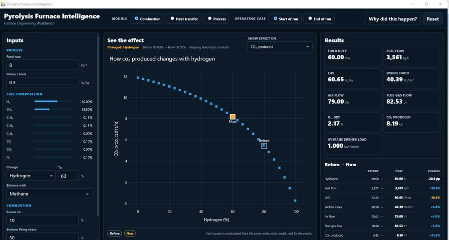
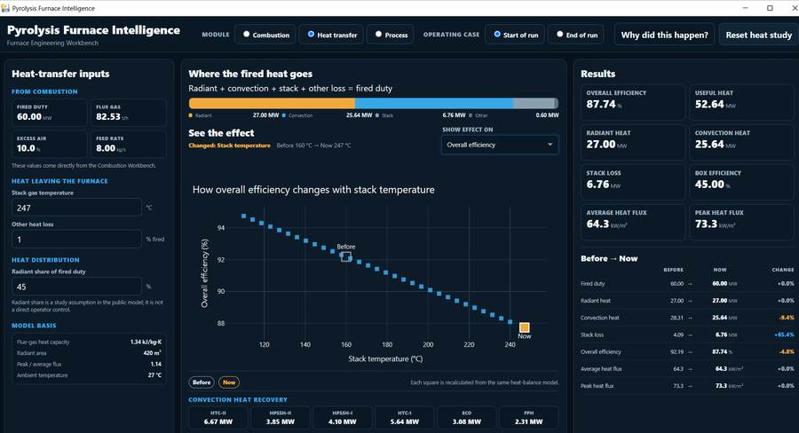
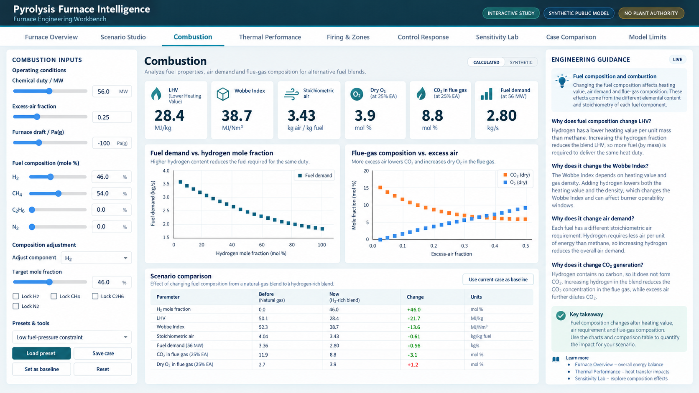

# Pyrolysis Furnace Intelligence

**Pyrolysis Furnace Intelligence** is an interactive engineering workbench for steam-cracking furnaces. It combines combustion, furnace heat transfer and process-side pyrolysis indicators in a connected mathematical model for engineering what-if studies.

**Model boundary:** This is a public, reduced-order engineering study, not a plant digital twin, CFD simulation, advanced process controller, burner management system or safety tool. Public cases use generalised or synthetic inputs.

## Screenshots

| Combustion workbench | Heat transfer workbench |
|:--:|:--:|
|  |  |

## What I developed

I developed a **physics-based mathematical modelling project** that links changes in furnace operating conditions to their calculated consequences. Its key contribution is the integration of established physical equations into one transparent, interactive computational workflow:

**Fuel composition → combustion and fired duty → furnace energy balance → process-side response.**

The application also provides baseline-versus-modified case comparisons, sensitivity curves and bounded engineering explanations. The contribution is the integrated model formulation and its implementation, **not** a claim to have invented a new mathematical theory.

## Computational framework

The application uses a **coupled, deterministic, steady-state, reduced-order computational framework** implemented in Python.

| Layer | What it calculates |
|---|---|
| **Combustion** | Fuel molecular weight, mass and volumetric lower heating value (LHV), Wobbe Index, stoichiometric and actual air, wet/dry flue gas, CO₂ production, fuel demand and burner loading |
| **Heat transfer** | Radiant absorption, convection heat recovery, stack and other losses, overall and box efficiency, average and peak *teaching* heat flux |
| **Process** | Sensible heating, residual reaction-duty estimate, coil pressure drop, hydrocarbon partial pressure, residence time and relative time-temperature cracking severity |
| **Sensitivity studies** | Repeated recalculation of supported inputs, one variable at a time, with a consistent model state and Before → Now comparisons |

The current combustion result supplies fired duty and flue-gas flow to the heat-transfer model. The process model then uses the current feed and steam conditions with the calculated radiant duty. This is **sequential steady-state coupling**, not a transient simulation.

## Mathematical methodology implemented

The framework combines **conservation laws**, direct algebraic calculations and **semi-empirical engineering correlations**.

### Combustion stoichiometry and fuel-mixture properties

Elemental balances determine the oxygen required for complete combustion:

$$
\nu_{O_2,\mathrm{st}}=C+\frac{H}{4}-\frac{O}{2}
$$

Mixture molecular weight and LHV are calculated from fuel mole fractions. Burner fuel interchangeability is examined with the lower Wobbe Index:

$$
WI_L=\frac{LHV_V}{\sqrt{SG}}
$$

Actual combustion air is calculated from stoichiometric demand and the selected excess-air fraction. The model accounts for a declared humid-air basis and calculates flue-gas composition.

### Furnace energy-balance modelling

The thermal model closes a lumped steady-state balance:

$$
Q_{\mathrm{fired}}=Q_{\mathrm{radiant}}+Q_{\mathrm{convection}}+Q_{\mathrm{stack}}+Q_{\mathrm{other}}
$$

Stack sensible-heat loss is estimated from flue-gas flow, an effective heat capacity and the stack-to-ambient temperature difference. Useful heat and efficiency follow from the closed balance.

### Reduced-order cracking-process modelling

Reference-based correlations estimate coil pressure drop and residence time. The process model uses ideal-gas volumetric flow and feed/steam molar flow to estimate hydrocarbon partial pressure. Radiant heat is separated into estimated sensible heating and a **residual** attributed to reaction duty; this residual is not a rigorous reaction-enthalpy prediction.

### Relative time-temperature severity index

A normalised study index represents the direction of changes in cracking severity:

$$
I_{\mathrm{TT}}=100\left(\frac{\tau}{\tau_{\mathrm{ref}}}\right)\exp\left[\beta(T_{\mathrm{COT}}-T_{\mathrm{COT,ref}})\right]
$$

The public implementation uses \(\beta=0.018\ ^\circ\mathrm{C}^{-1}\). The index is **not a validated kinetic rate law** and does not calculate off-design conversion or product yields.

### Deterministic sensitivity analysis

The numerical engine varies one supported input over a defined range and recalculates the connected state for each point. Fuel-component studies rebalance the composition to preserve mole-fraction closure. The retained educational firing-distribution module also preserves total firing during zone-share changes.

These are **parametric studies**, not numerical optimisation with a constrained objective function.

## Programming and numerical tools

| Purpose | Implementation |
|---|---|
| Mathematical calculation engine | **Python**, standard mathematical functions and direct algebraic evaluation |
| Numerical methodology | Deterministic parameter sweeps, composition closure and reduced-order correlations |
| Interactive application | **Dash** |
| Graphs and visualisation | **Plotly** |
| Public model parameters | **YAML / PyYAML** |
| Software tests | **pytest** |
| Packaging and continuous integration | **pyproject.toml**, GitHub Actions (Python 3.12) |

The public numerical model does not use CFD, machine learning, dynamic ODE integration or a formal nonlinear optimisation solver.

## Scope and validation

Supported calculations include complete-combustion accounting for declared fuel species, a closed furnace heat balance and reduced-order process indicators. The public test suite checks composition closure, physical balance consistency, expected response directions and cross-module coupling.

**Not claimed:** plant-calibrated predictions; detailed flame shape or NOx/CO emissions; tube-metal temperature, local heat flux or tube life; detailed cracking yields or coke-growth rates; PID dynamics or APC/BMS functionality; autonomous control or safe-to-operate decisions.

Passing automated tests confirms consistency with the stated equations and assumptions. It does **not** establish accuracy against a real operating furnace.

Further detail: [Technical methodology](docs/methodology.md) · [Heat-transfer methodology](docs/heat_transfer_methodology.md) · [Process methodology](docs/process_methodology.md) · [Model boundaries](docs/model_boundaries.md) · [Public validation](docs/validation.md) · [Reproducibility](docs/reproducibility.md)

## Windows desktop

**[Install Pyrolysis Furnace Intelligence from the Microsoft Store](https://apps.microsoft.com/detail/9NB6K57T831H?hl=en-us&gl=GB)**

The Microsoft Store version is the recommended Windows installation route. It installs the packaged desktop application directly and does not require a separate Python installation. A direct EXE installer is also available from [GitHub Releases](https://github.com/abbasrajaei/Pyrolysis-Furnace-Intelligence/releases/latest), although the direct installer is unsigned and may trigger a Windows SmartScreen warning.

To run from source with the tested Python 3.12 environment:

~~~bash
git clone https://github.com/abbasrajaei/Pyrolysis-Furnace-Intelligence.git
cd Pyrolysis-Furnace-Intelligence
python -m venv .venv
# activate the environment, then:
python -m pip install ".[test]"
python app/app.py
~~~

Open http://127.0.0.1:8050.

## Repository structure

| Path | Contents |
|---|---|
| [src/pyrolysis_furnace_intelligence/](src/pyrolysis_furnace_intelligence/) | Mathematical modelling engines and educational control modules |
| [app/](app/) | Dash engineering workbench |
| [docs/](docs/) | Methodology, assumptions, model limits and validation |
| [examples/](examples/) | Reproducible example runs |
| [tests/](tests/) | Automated verification |
| [assets/](assets/) | Workbench screenshots and supporting figures |

## Author and privacy

**Abbas Rajaei — Chemical / Process Engineer**

This project forms part of my continuing work on industrial combustion, furnace optimisation and energy efficiency. It is intended to demonstrate inspectable engineering reasoning using publicly shareable model inputs.

The desktop workbench is designed to run locally and does not intentionally collect or transmit personal data. See [Privacy Policy](PRIVACY.md).